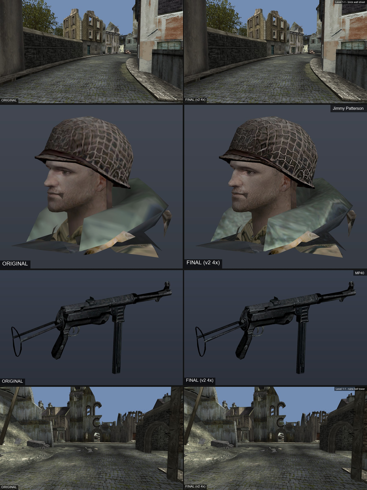
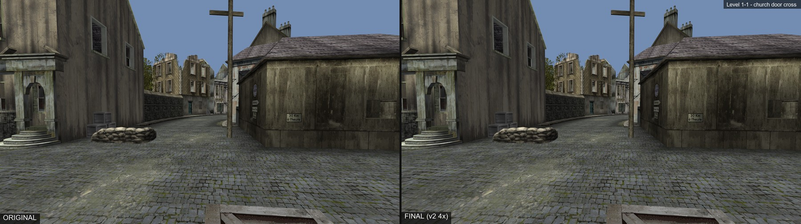
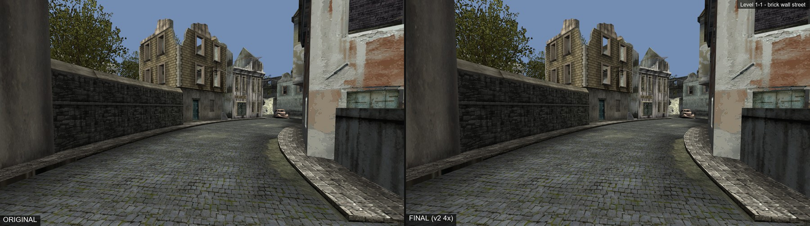
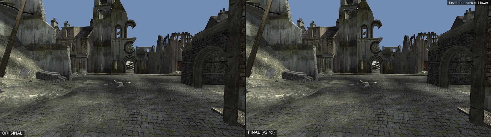
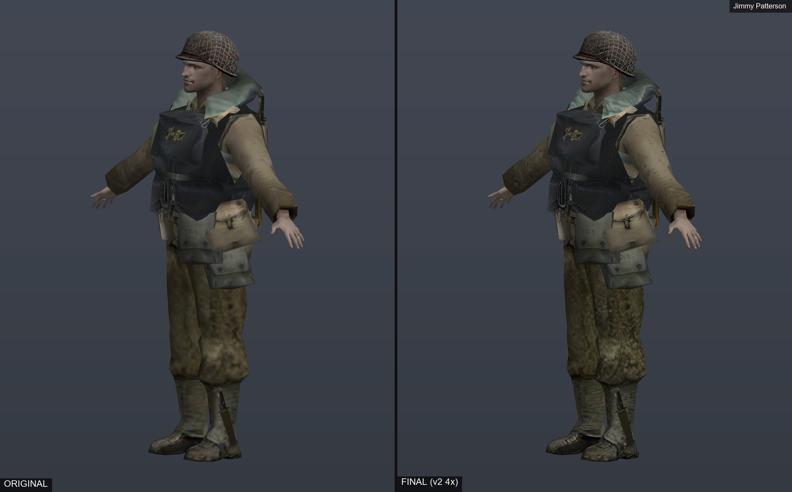
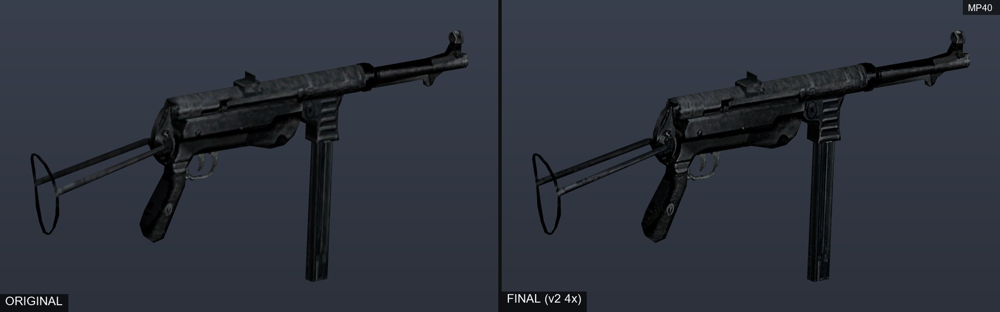
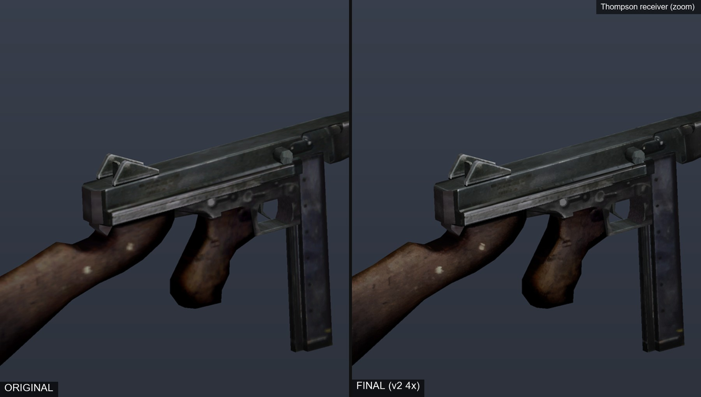

# Medal Of Honor: Front Line - Dolphin HD Texture Pack

> ## ⚠️ YOU NEED ALL 3 ZIPS
> The pack is split into **three** downloads (GitHub limits a single file to 2 GB). **Download and extract all three into the same folder.** If you only install some of them, parts of the game will look original or mixed.
>
> After extracting all three you should have **6,831 PNG files** in `Load\Textures\GMFE69`. See [Did I install everything?](#did-i-install-everything).

An unofficial, fan-made, **4x AI-upscaled HD texture pack** for **Medal of Honor: Frontline** (GameCube, NTSC-U, Dolphin game ID **GMFE69**), for use with the [Dolphin emulator](https://dolphin-emu.org/).

**Downloads:** see the [Releases page](../../releases/latest) (v1.0.0).

| # | File | Size | Textures | Contents |
|---|------|------|---------:|----------|
| 1 | `MOHFL_HD_Textures_GMFE69_Core_1of2.zip` | 1,074,437,225 bytes (~1.0 GiB) | 2,474 | Core textures, part 1 of 2 (levels, characters, weapons, props, etc.) |
| 2 | `MOHFL_HD_Textures_GMFE69_Core_2of2.zip` | 1,074,702,969 bytes (~1.0 GiB) | 4,091 | Core textures, part 2 of 2 |
| 3 | `MOHFL_HD_Textures_GMFE69_Menus_Briefing_Loading.zip` | 1,355,761,418 bytes (~1.26 GiB) | 266 | Menu, briefing and loading-screen textures, plus `README.txt`, `LICENSE_LEGAL.txt` and a preview image |
| | **Total** | **~3.5 GB** | **6,831** | |

The two "Core" zips are simply the main set split in half by file name so that each stays under GitHub's 2 GB limit; they have no separate meaning. All three zips contain the same folder layout (`Load\Textures\GMFE69\...`), so they **merge** into one folder.

## Preview

Left = original, right = this pack (renders from the author's own viewers, not Dolphin screenshots):



More stills (each image is original on the left, pack on the right):








## What this is

6,831 upscaled copies of the game's own textures (about 3.3 GiB unpacked), named the way Dolphin looks them up (`tex1_<width>x<height>_<hash>[_<tlut hash>]_<format>.png`). Dolphin loads them in place of the originals when **Load Custom Textures** is on. The pack covers level geometry, soldiers, Jimmy Patterson, props, many weapons, and many menu / briefing / loading screens.

It contains **no game files**, no code and no AI model files - only upscaled textures.

## About the project

This pack is a side product of a bigger personal project: a native PC port effort of *Medal of Honor: Frontline*, working from roughly 350,000 lines of PowerPC code. That port work is **currently paused until November 2026**. Alongside it I have been doing texture upscaling work, which is what this pack is. I have loved this game since childhood, and this pack is a way of giving something back to other fans while the larger project is on hold.

(The pack itself is independent of the port: it works in Dolphin with your own disc dump.)

## Requirements

- Your **own legally obtained copy** of Medal of Honor: Frontline - a dump you made yourself of the **NTSC-U (GMFE69)** GameCube disc. Other regions use different texture hashes and will not work.
- **Dolphin 2609a or a recent build.**
- About 3.5 GB of free disk space for the zips and roughly the same again for the extracted files.
- A GPU with a reasonable amount of VRAM. Raising the internal resolution to 2x or more is recommended, since the textures are 4x the original size.

## Installation

1. **Download all 3 zips** from the [Releases page](../../releases/latest).
2. **Close Dolphin.**
3. **Extract all three zips into the same folder** (a temporary folder on your desktop is fine). If Windows asks to merge folders or replace files, choose merge / replace. The only file that appears in every zip is `READ_ME_FIRST_YOU_NEED_ALL_3_ZIPS.txt`, and it is identical in all of them.
   You should end up with one folder: `Load\Textures\GMFE69\` containing 6,831 `.png` files.
4. **Copy the `Load` folder into Dolphin's user folder** (merge into any existing `Load` folder):
   - **Normal install:** `%APPDATA%\Dolphin Emulator\Load\Textures\GMFE69\` (paste `%APPDATA%\Dolphin Emulator` into the Explorer address bar).
   - **Portable Dolphin:** `<your Dolphin folder>\User\Load\Textures\GMFE69\`
   - If you changed the Load path in Dolphin (Config > Paths), use that path instead.

   The `.png` files must sit **directly inside** `GMFE69`, not in a sub-folder.
5. **Turn on custom textures in Dolphin:** right-click the game > Properties > Graphics > **Advanced** (or the main Graphics button > Advanced) and tick:
   - **Load Custom Textures** (required)
   - **Prefetch Custom Textures** (recommended: loads everything up front to avoid stutter; needs more RAM and the first load takes longer)
6. Start the game. Consider raising the internal resolution to 2x or higher.

### Did I install everything?

Expected: **6,831** PNG files directly inside `Load\Textures\GMFE69`. In PowerShell (normal install):

```powershell
(Get-ChildItem "$env:APPDATA\Dolphin Emulator\Load\Textures\GMFE69" -Filter *.png).Count
```

If the number is lower, one of the three zips is missing (2,474 + 4,091 + 266 = 6,831). If you had other custom textures in that folder from before, the number can be higher.

### Uninstall

Close Dolphin and delete the `.png` files you installed (or the whole `Load\Textures\GMFE69` folder if it holds nothing else you want to keep).

## Verifying downloads

[`CHECKSUMS.sha256`](CHECKSUMS.sha256) lists the SHA-256 of each zip, so you can confirm your download is intact:

```powershell
Get-FileHash .\MOHFL_HD_Textures_GMFE69_Core_1of2.zip -Algorithm SHA256
Get-FileHash .\MOHFL_HD_Textures_GMFE69_Core_2of2.zip -Algorithm SHA256
Get-FileHash .\MOHFL_HD_Textures_GMFE69_Menus_Briefing_Loading.zip -Algorithm SHA256
```

| File | SHA-256 |
|------|---------|
| `MOHFL_HD_Textures_GMFE69_Core_1of2.zip` | `f3003b73d817197e50b631e05cf092aa2be0bc630fd76374a3229c913147c67e` |
| `MOHFL_HD_Textures_GMFE69_Core_2of2.zip` | `b223f42fe9dfe972965829c2954387c17b7aaeb7c64eace683720dff71c520ca` |
| `MOHFL_HD_Textures_GMFE69_Menus_Briefing_Loading.zip` | `8227fdf147321e0176e72750de6e289a9a05df5cb57015bb17f99f1a5e7535bf` |

[`FILE_MANIFEST.sha256`](FILE_MANIFEST.sha256) lists the SHA-256 of **each of the 6,831 textures** (in `sha256sum` format) if you want to check an installed copy file by file.

## How it was made

1. The original textures were **decoded from the author's own disc dump** and given Dolphin's hash-based names (`tex1_WxH_hash_fmt`).
2. Each texture was upscaled 4x with the AI models **4x-Struzan** and **4xHDcube4** and the two results were **blended 50/50**.
3. Textures were **padded** before upscaling (wrap padding for tiling textures, reflect padding for the rest) so that edges do not show seams, and the padding was **cropped** afterwards.
4. A **mild unsharp mask** was applied.
5. Output files keep the exact Dolphin hash names so Dolphin picks them up automatically.

**No model files are redistributed** in this pack or this repository.

## What to keep in mind

- This is an **almost 25-year-old game** and the only source material is what is on the disc. AI upscaling **invents detail**; it does not recover the original artists' high-resolution art. Some textures will look great, some will look different from the original intent.
- **HUD / UI pieces were intentionally left original.** Many are packed into shared sprite sheets and upscaling them broke things such as the pause-menu icons.
- **14 menu pieces were held back** (left original) for the same reason.
- **First-person weapons** may not be replaced yet: the weapon textures are in the pack, but some players (including me) do not see a visible change on them in game. This is being looked into.
- Some textures can look **crunchy or grainy**, especially dark and noisy ones.
- **Foliage / fence alpha edges** can look blocky.
- About **4 textures may not tile perfectly** and could show a faint seam. If you find one, delete that file to revert it to the original and [open an issue](../../issues).
- **Historical emblems:** this pack does not alter or remove historically relevant emblems. **I will not be changing files to obscure/remove historically relevant emblems.** The textures are upscales of what is on the disc.

## Known issues

- First-person weapon textures may look unchanged (see above).
- Foliage / alpha-edge blockiness; occasional crunchy textures.
- A handful of textures may show a seam when tiled.
- HUD, small icons and some menu pieces are original resolution by design.
- Only the NTSC-U version (GMFE69) is supported. Tested only on Windows.

## Reporting bugs

Please use the **[Issues page](../../issues)** ([direct link](https://github.com/TheOnePersonYouHate/Medal-Of-Honor-Front-Line-Dolphin-HD-Texture-Pack/issues)). Include:

- the **level / screen** where you see the problem,
- a **screenshot** (and, if you can, one with the pack removed for comparison),
- your Dolphin version, internal resolution, and whether Prefetch is on.

## Credits

- **[4x-Struzan](https://openmodeldb.info/models/4x-Struzan)** by **Laserschwert** (CC-BY-NC-SA-4.0 per OpenModelDB).
- **4xHDcube4** by **Venomalia** (HDcube Model License; the model author makes no copyright claim on its outputs).
- **[Dolphin Emulator](https://dolphin-emu.org/)** - the emulator these textures are made for, and its custom-texture format.
- Tooling used to run the models and process images: [spandrel](https://github.com/chaiNNer-org/spandrel), PyTorch, NumPy and Pillow (Python).
- The original game, art and textures belong to **Electronic Arts** and the original developers.
- Pack by **TheOnePersonYouHate**.

## Legal / Disclaimer

- This pack is **free and non-commercial**. It must not be sold, put behind a paywall, ad-wall or paid hosting, or bundled into anything sold.
- *Medal of Honor: Frontline* and all of its original assets are owned by **Electronic Arts Inc.** and the original developers. This is an **unofficial fan work**, **not affiliated with or endorsed by EA**.
- The pack contains **no game files** (no executables, scripts, models or other assets) - only textures derived from the game's own textures. You need your own legally obtained copy of the game for it to be of any use.
- Provided **as is**, with no warranty.
- **Removal on request:** if you are a rights holder and want something removed, open an issue and it will be taken down.

See [NOTICE.md](NOTICE.md) for the full notice.

## FAQ

**Do I need all three zips?** Yes. Extract all three into the same folder; together they make the full 6,831 textures.

**Why is it split into three files?** GitHub limits each release file to 2 GB, and the whole pack is about 3.5 GB.

**Does it work on the PAL / Japanese version?** No. Only NTSC-U (GMFE69). Other regions use different texture hashes.

**Do I need to modify the game or ISO?** No. Dolphin loads the PNGs from its `Load\Textures\GMFE69` folder; the game files are untouched.

**It looks the same / nothing changed.** Check that Load Custom Textures is ticked, that the files are directly inside `Load\Textures\GMFE69`, that the game ID is GMFE69, and that the count is 6,831. Then fully restart the game.

**It stutters.** Turn on Prefetch Custom Textures, make sure you have enough RAM/VRAM, and try a lower internal resolution.

**Can I redistribute it?** Only free of charge, non-commercially, with `LICENSE_LEGAL.txt` / `NOTICE.md` kept alongside, and without claiming it is official.

**Are the models included?** No. Neither model is redistributed.

**Can I use my own different texture pack on top?** Yes - Dolphin uses the files it finds; files with the same name will overwrite each other.